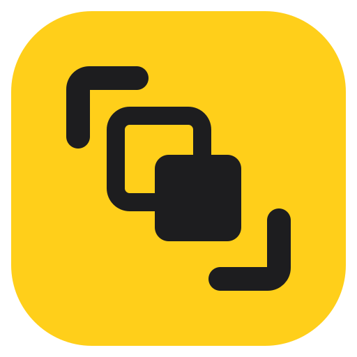

<p align="center">
  
</p>

<h1 align="center">ShotPaste</h1>

<p align="center">
  <b>Capture it. Record it. Paste it again.</b><br>
  Screenshots, screen recordings and clipboard history for macOS. Free and open source.
</p>

<p align="center">
  <a href="https://github.com/Treposting/cleanshot-x-paste/releases/latest"><b>Download</b></a> ·
  <a href="https://treposting.github.io/cleanshot-x-paste/">Website</a> ·
  <a href="docs/HOW-IT-WORKS.md">How it works</a>
</p>

---

## Features

- **Screenshots**: capture an area, a window or the full screen, with an optional self-timer
- **Screen recording**: MP4 at 30/60 fps with optional computer audio, plus one-click GIF export
- **Quick Access overlay**: copy, save, annotate or pin a capture, or drag it into any app
- **Annotate**: arrows, shapes, text, highlights, numbered steps and pixelate
- **OCR**: select part of the screen and copy the text in it
- **Clipboard history**: search, filter, pin, and paste straight into the app you're using
- **Private**: runs entirely on your Mac and skips passwords copied from password managers

## Shortcuts

| Action | Default |
|---|---|
| Capture area / window / fullscreen | <kbd>⌥⇧⌘4</kbd> <kbd>⌥⇧⌘5</kbd> <kbd>⌥⇧⌘3</kbd> |
| Copy text (OCR) | <kbd>⌥⇧⌘2</kbd> |
| Record area / screen (press again to stop) | <kbd>⌥⇧⌘6</kbd> <kbd>⌥⇧⌘7</kbd> |
| Clipboard history | <kbd>⇧⌘V</kbd> |

You can change any shortcut in **Settings → Shortcuts**.

## Install

1. Download the `.dmg` from [Releases](https://github.com/Treposting/cleanshot-x-paste/releases/latest) and drag ShotPaste to Applications.
2. On first launch, right-click the app and choose **Open**. The app isn't notarized yet, so macOS needs this once.
3. Allow **Screen Recording** when macOS asks. **Accessibility** is optional and lets ShotPaste paste into other apps for you.

Requires macOS 13 or later and runs natively on Apple Silicon and Intel.

## Build from source

```sh
git clone https://github.com/Treposting/cleanshot-x-paste.git
cd cleanshot-x-paste
make run    # build and launch
make dmg    # universal DMG in build/
```

Requires Xcode 15 or later. To publish a release, bump the version in `Resources/Info.plist` and push a `v*` tag. CI then builds the DMG and attaches it to a GitHub Release.

## License

[MIT](LICENSE). ShotPaste is an independent project built only on public Apple APIs, and it isn't affiliated with any commercial app.
