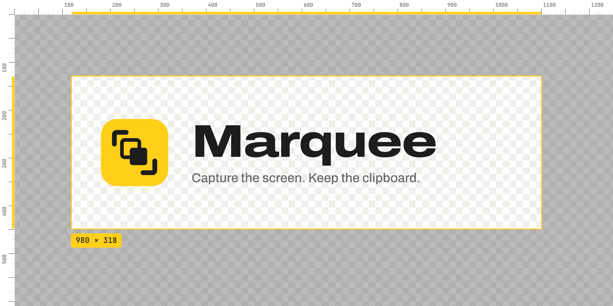

<div align="center">

<picture>
  <source media="(prefers-color-scheme: dark)" srcset="docs/assets/banner-dark.png">
  
</picture>

A free, open-source menu-bar app for macOS that takes screenshots and screen recordings, and remembers everything you copy.

[](https://github.com/Treposting/marquee/actions/workflows/build.yml)
[](https://github.com/Treposting/marquee/releases/latest)

[](LICENSE)

[**Download**](https://github.com/Treposting/marquee/releases/latest) &nbsp;·&nbsp;
[Website](https://treposting.github.io/marquee/) &nbsp;·&nbsp;
[How it works](docs/HOW-IT-WORKS.md) &nbsp;·&nbsp;
[Report a bug](https://github.com/Treposting/marquee/issues)

</div>

---

## Contents

- [What's new in 0.2](#whats-new-in-02)
- [Features](#features)
- [Install](#install)
- [Using Marquee](#using-marquee)
- [Privacy](#privacy)
- [Build from source](#build-from-source)
- [Troubleshooting](#troubleshooting)
- [Coming next: Measure](#coming-next-measure)
- [Roadmap](#roadmap)
- [Contributing](#contributing)
- [License](#license)

## What's new in 0.2

> **ShotPaste is now Marquee.** The app was renamed now that it covers capture, clipboard history and (soon) measuring. If you used ShotPaste 0.2.0, Marquee moves your clipboard history, settings and shortcuts over the first time it runs. macOS treats it as a new app, so it asks for Screen Recording and Accessibility again.

- **Screen recording.** Record an area or the full screen to MP4, then save it as a GIF.
- **Custom shortcuts.** Change every global shortcut in Settings.
- **DMG installer.** One universal download for Apple Silicon and Intel.
- **New look.** A new logo and app icon, and a [website](https://treposting.github.io/marquee/).

See all [releases](https://github.com/Treposting/marquee/releases).

## Features

### Capture

- **Area, window or full screen.** Uses the native macOS crosshair, so Space switches to window mode and Esc cancels.
- **Self-timer.** Captures the full screen after 5 seconds.
- **Copy text (OCR).** Select part of the screen and the text in it goes to your clipboard. It uses Apple's Vision framework on your Mac.
- **Quick Access overlay.** A thumbnail appears after each capture. Copy it, save it, annotate it, pin it, or drag it straight into Slack, Mail or Finder.
- **Annotate.** Add arrows, rectangles, ellipses, freehand pen, highlights, text and numbered steps. Pixelate anything sensitive.
- **Pin to screen.** Keep a screenshot floating above every window.

### Record

- **Area or full screen** to MP4 (H.264), at 30 or 60 fps.
- **Computer audio** and **cursor**, each optional.
- **Menu-bar timer.** The icon turns into a red stop button while you record.
- **Save as GIF** from the overlay with one click.

### Clipboard history

- **Remembers** text, links, images and files, along with the app each one came from.
- **Opens with ⇧⌘V** as a panel along the bottom of the screen. Type to search, or filter by type.
- **Pastes into the app you were using**, which stays in front the whole time.
- **Pin** items you reuse. Duplicates move to the front instead of piling up.
- **Includes your screenshots.** Every one you copy also lands in history.

## Install

1. Download `Marquee-x.y.z.dmg` from the [latest release](https://github.com/Treposting/marquee/releases/latest).
2. Open the DMG and drag **Marquee** into **Applications**.
3. Releases aren't notarized by Apple yet, so the first launch needs one of these:
   - right-click the app and choose **Open**, or
   - run `xattr -dr com.apple.quarantine /Applications/Marquee.app`.

Marquee runs on **macOS 13 Ventura or later**. The DMG is a universal build, so it runs natively on Apple Silicon and Intel.

### Permissions

| Permission | Needed for | When macOS asks |
|---|---|---|
| **Screen & System Audio Recording** | Screenshots of other apps, screen recording, computer audio | On your first capture. Quit and reopen Marquee after allowing it. |
| **Accessibility** | Pasting a history item straight into the active app | The first time you paste from history. Without it, the item is copied and you press ⌘V yourself. |

## Using Marquee

### Global shortcuts

You can change these in **Settings → Shortcuts**. Click a shortcut and press new keys, press ⌫ to remove it, or click ↺ to restore its default.

| Action | Default |
|---|---|
| Capture area | <kbd>⌥</kbd><kbd>⇧</kbd><kbd>⌘</kbd><kbd>4</kbd> |
| Capture window | <kbd>⌥</kbd><kbd>⇧</kbd><kbd>⌘</kbd><kbd>5</kbd> |
| Capture full screen | <kbd>⌥</kbd><kbd>⇧</kbd><kbd>⌘</kbd><kbd>3</kbd> |
| Capture full screen in 5 s | none |
| Copy text (OCR) | <kbd>⌥</kbd><kbd>⇧</kbd><kbd>⌘</kbd><kbd>2</kbd> |
| Record area (press again to stop) | <kbd>⌥</kbd><kbd>⇧</kbd><kbd>⌘</kbd><kbd>6</kbd> |
| Record screen (press again to stop) | <kbd>⌥</kbd><kbd>⇧</kbd><kbd>⌘</kbd><kbd>7</kbd> |
| Clipboard history | <kbd>⇧</kbd><kbd>⌘</kbd><kbd>V</kbd> |

### In the clipboard panel

| Key | Action |
|---|---|
| Type | Search |
| <kbd>←</kbd> <kbd>→</kbd> | Select an item |
| <kbd>↩</kbd> or double-click | Paste |
| <kbd>⌘</kbd><kbd>1</kbd>–<kbd>⌘</kbd><kbd>9</kbd> | Paste one of the first nine items |
| <kbd>⌘</kbd><kbd>P</kbd> | Pin or unpin |
| <kbd>⌘</kbd><kbd>⌫</kbd> | Delete |
| <kbd>Esc</kbd> | Close |

### In the annotation editor

| Key | Action |
|---|---|
| <kbd>⌘</kbd><kbd>Z</kbd> / <kbd>⇧</kbd><kbd>⌘</kbd><kbd>Z</kbd> | Undo / redo |
| <kbd>⌘</kbd><kbd>C</kbd> | Copy the annotated image |
| <kbd>⌘</kbd><kbd>S</kbd> | Save as… |
| <kbd>⌘</kbd><kbd>↩</kbd> | Done |

### When recording an area

Drag to select. Press <kbd>↩</kbd> to record the whole screen instead, or <kbd>Esc</kbd> to cancel. To stop, click the red button in the menu bar or press the record shortcut again.

### Settings

| Tab | What you can change |
|---|---|
| Capture | Show the overlay, auto-hide it, copy and/or save after capture, save folder, shutter sound, window shadow, launch at login |
| Recording | Frame rate, cursor, computer audio |
| Clipboard | Turn history on or off, history size (100 to 5,000 items), paste directly into apps |
| Shortcuts | Every global shortcut |

## Privacy

- **No account and no network requests.** Captures and history never leave your Mac.
- **Clipboard history** is stored in `~/Library/Application Support/Marquee/`. Clear it from the menu bar at any time; pinned items are kept.
- **Passwords are skipped.** Password managers mark what they copy with `org.nspasteboard.ConcealedType` or `TransientType`. Marquee never records those items.
- **Pause history** from the menu bar when you're copying something sensitive.

## Build from source

You need macOS 13+ and Xcode 15+ (or the Swift 5.9 command-line tools).

```sh
git clone https://github.com/Treposting/marquee.git
cd marquee
make run
```

| Command | What it does |
|---|---|
| `make build` | Debug build with SwiftPM |
| `make run` | Builds `build/Marquee.app` and opens it |
| `make install` | Copies the app to `/Applications` |
| `make dmg` | Universal build, packaged as `build/Marquee-<version>.dmg` |
| `make clean` | Removes build output |

You can also open `Package.swift` in Xcode and press Run.

The app has no third-party dependencies. It is built entirely on Apple frameworks:

| Feature | Framework |
|---|---|
| Screenshots | `screencapture` |
| Recording | ScreenCaptureKit, AVFoundation |
| OCR | Vision |
| Clipboard | NSPasteboard |
| Global shortcuts | Carbon |

[docs/HOW-IT-WORKS.md](docs/HOW-IT-WORKS.md) explains each feature and the API behind it.

<details>
<summary><b>Project layout</b></summary>

```
Sources/Marquee/
├── App/         Entry point, menu bar, global shortcuts, preferences
├── Capture/     Screenshots, Quick Access overlay, pinned windows, OCR
├── Record/      ScreenCaptureKit recorder, MP4 writer, area picker, GIF export
├── Annotate/    Annotation model, renderer and editor window
├── Clipboard/   Pasteboard monitor, history store, history panel, auto-paste
└── UI/          Settings, shortcut recorder, toast messages
scripts/         App bundle, icon and DMG build scripts
site/            Website (deployed to GitHub Pages)
```

</details>

## Troubleshooting

<details>
<summary><b>Captures only show my desktop wallpaper</b></summary>

Marquee doesn't have Screen Recording permission yet. Open **System Settings → Privacy & Security → Screen & System Audio Recording**, turn Marquee on, then quit and reopen it.
</details>

<details>
<summary><b>macOS asks for permissions again after I rebuild</b></summary>

Local builds are signed ad hoc, and macOS ties permissions to the signature. To keep permissions across rebuilds, sign with a stable identity, such as a self-signed certificate made in Keychain Access:

```sh
SIGN_IDENTITY="Your Certificate Name" make app
```
</details>

<details>
<summary><b>⇧⌘V no longer does "Paste and Match Style"</b></summary>

Marquee uses that shortcut for clipboard history by default. Change it in **Settings → Shortcuts** if you'd rather keep the app's own shortcut.
</details>

<details>
<summary><b>A shortcut does nothing</b></summary>

Another app may already own that key combination. Pick a different one in **Settings → Shortcuts**.
</details>

## Coming next: Measure

A PixelSnap-style measuring tool:
- point at anything on screen to see its distance to the surrounding edges;
- drag around an element to snap to its exact size;
- add guides to check alignment.

The design and milestones are in [docs/plans/MEASURE.md](docs/plans/MEASURE.md).

## Roadmap

- [x] Screenshots, annotation, OCR, pinning
- [x] Clipboard history with search and direct paste
- [x] Screen recording with GIF export
- [x] Customizable shortcuts
- [x] Universal DMG and GitHub Releases
- [ ] Measure: an on-screen ruler that snaps to the edges of UI elements and shows distances in points, like [PixelSnap](https://pixelsnap.com)
- [ ] Microphone audio and webcam overlay in recordings
- [ ] Scrolling capture
- [ ] Rich text (RTF/HTML) in clipboard history
- [ ] Exclude specific apps from history
- [ ] Notarized releases

Ideas and requests are welcome in [Issues](https://github.com/Treposting/marquee/issues).

## Contributing

1. Fork the repo and create a branch from `main`.
2. Make your change. `make run` builds and launches the app.
3. Open a pull request. CI builds the universal app and DMG on every push, and it needs to pass.

### Releasing

1. Go to **Actions → Release → Run workflow**.
2. Enter a version such as `0.3.0`, or leave it empty to release the version already in `Resources/Info.plist`.

The workflow updates `Info.plist` if the version changed, builds the universal DMG, creates the `v0.3.0` tag, and publishes a GitHub Release with the DMG and generated release notes.

Pushing a `v*` tag by hand also works.

## License

[MIT](LICENSE).

Marquee is an independent project. It is built only on public Apple APIs and contains no code or assets from any commercial app.
